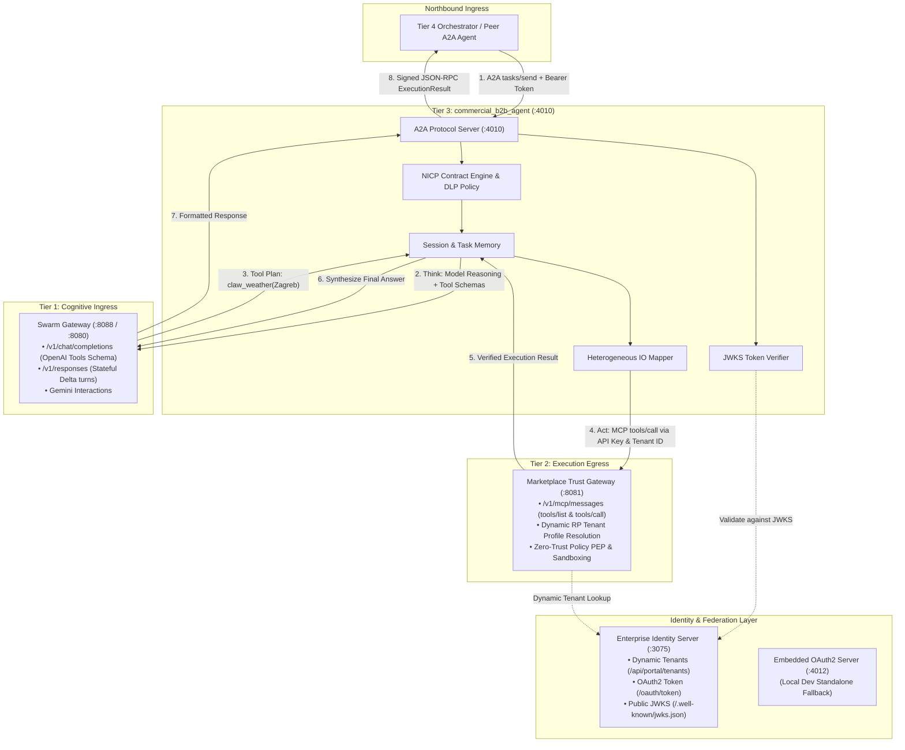

# Commercial B2B Agent (`commercial_b2b_agent`)

> **Tier 3 Autonomous Worker** in the 4-Tier Enterprise Agentic Architecture.  
> Coordinated by the Outcome Layer (Tier 4), powered by Swarm Gateway (Tier 1 Cognitive Ingress), strictly bounded by Marketplace Trust Gateway (Tier 2 Execution Egress), and federated via Sovereign Identity (Port 3075).

---

## 1. Architectural Philosophy: The 4-Tier Stack + Identity Federation

Enterprise agentic deployments fail when cognition, execution, credentials, identity, and state are conflated within a single runtime. `commercial_b2b_agent` operates as a sovereign, specialized **Tier 3 Autonomous Worker** within a strictly partitioned 4-tier topology with decoupled identity governance:

```text
┌────────────────────────────────────────────────────────────────────────┐
│ TIER 4: OUTCOME ORCHESTRATOR (The Control Plane)                       │
│ Business goal decomposition, SLA tracking, and multi-agent DAGs        │
└───────────────────────────────────┬────────────────────────────────────┘
                                    │ Northbound A2A Tasks + Signed JWT / SSI
                                    ▼
┌────────────────────────────────────────────────────────────────────────┐
│ TIER 3: COMMERCIAL B2B AGENT (The Autonomous Worker :4010)             │
│ Domain-tuned state loops, task memory, and defense-in-depth security   │
└─────────┬─────────────────────────┬──────────────────────────┬─────────┘
          │ 1. Validate Token       │ 2. Think                 │ 3. Act
          │ (JWKS :3075 / :4012)    │ Cognitive Ingress        │ Execution Egress
          ▼                         ▼ (Chat / Responses)       ▼ (MCP Zero-Trust)
┌──────────────────┐      ┌─────────────────────┐    ┌───────────────────────────┐
│ IDENTITY SERVER  │      │ TIER 1:             │    │ TIER 2:                   │
│ (Port 3075 IdP)  │      │ SWARM GATEWAY       │    │ MARKETPLACE TRUST GATEWAY │
├──────────────────┤      │ (Port 8088 / 8080)  │    │ (Port 8081)               │
│ • Sovereign OIDC │      ├─────────────────────┤    ├───────────────────────────┤
│ • Dynamic RP     │      │ • Model routing     │    │ • Zero-Trust Execution    │
│ • Tenant Registry│      │ • Token & quota mgmt│    │ • Dynamic RP verification │
│ • Ed25519 JWKS   │      │ • Zero agent state  │    │ • Sandboxed MCP tools     │
└──────────────────┘      └──────────┬──────────┘    └─────────────┬─────────────┘
                                     ▼                             ▼
                              LLM Providers                 Enterprise Core
                       (Groq, OpenAI, Gemini)         (APIs, DBs, Native Skills)
```

| Tier / Component | Port | Role | Core Responsibility |
|---|---|---|---|
| **Tier 4 Orchestrator** | Dynamic | Control Plane | Decomposes business goals into directed acyclic graphs (DAGs) and delegates sub-tasks to Tier 3 workers via A2A protocol. |
| **Tier 3 `commercial_b2b_agent`** | `4010` | Autonomous Worker | Executes business objectives, verifies caller tokens, reasons via Swarm Gateway, and invokes tools exclusively through Trust Gateway. |
| **Tier 2 Marketplace Trust Gateway** | `8081` | Execution Firewall | Evaluates zero-trust policies, dynamically resolves tenant RP profiles, and executes sandboxed tool calls. |
| **Tier 1 Swarm Gateway** | `8088` (or `8080`) | Cognitive Proxy | Multiplexes LLM backends (OpenAI, Gemini, Groq, local models), manages token budgets, and formats cognitive schemas. |
| **Enterprise Identity Server** | `3075` | Sovereign IdP | Dynamic multi-tenant Relying Party (RP) registry, tenant onboarding, client credential issuance, and Ed25519 JWKS host. |
| **Embedded OAuth2 Server** | `4012` | Local Dev IdP | Optional standalone fallback token issuer (disabled by default; enable via `B2B_ENABLE_EMBEDDED_OAUTH=true`). Primary authority is `identity_server` on port `3075`. |
| **NATS JetStream** | `4222` | Event & State Bus | Caches counterparty public keys (`did_web_cache`) and distributes dynamic Semantic DLP policies. |

---

## 2. Dual-Gateway Perimeter Architecture

The agent is bounded by a **Dual-Gateway Perimeter**:



### 2.1 Cognitive Ingress (Swarm Gateway)
All model reasoning is offloaded to `swarm_gateway` (default: `http://127.0.0.1:8088` or `8080`). The agent holds **zero direct external LLM credentials** (`INV-PERIMETER-01`) and supports three pluggable wire formats configured via `SWARM_COGNITIVE_FORMAT`:
1. **Stateless OpenAI Chat Completions** (`SWARM_COGNITIVE_FORMAT="chat_completions"`, `POST /v1/chat/completions`):
   - Forwards active MCP tool definitions (`claw_weather`, NICP tools) directly in the `tools` array.
   - Recommended for full tool invocation workflows.
2. **Stateful Open Responses** (`SWARM_COGNITIVE_FORMAT="responses"`, `POST /v1/responses`):
   - Delta-only turns chained through `previous_response_id` backed by Swarm's session store, avoiding sending megabytes of historical contract negotiations.
3. **Google Gemini Native Format** (`SWARM_COGNITIVE_FORMAT="gemini"`, `GeminiInteractionRequest`):
   - Direct multimodal and structured tool interaction using native Gemini parts.

### 2.2 Execution Egress (Marketplace Trust Gateway)
All tool mutations and external calls are offloaded to `marketplace_trust_gateway` (default: `http://127.0.0.1:8081`). The agent holds **zero local shell or mutation privileges** (`INV-EXECUTION-01`):
- **Tool Discovery**: Dynamically queries active tool bundles via MCP `tools/list`.
- **Egress Authentication**: Calls MCP endpoints using the configured `TRUST_GATEWAY_API_KEY`.
- **Tenant Context**: Injects `X-Tenant-ID` into every request header.
- **Dynamic Relying Party Federation**: Trust Gateway dynamically queries the Identity Server (`$IDENTITY_SERVER_URL/api/portal/tenants`) to resolve any tenant's `issuer_url` and `jwks_url`, verifying cryptographic claims without hardcoded static profiles.
- **Sandboxed Execution**: Trust Gateway enforces tenant policies, evaluates caller permissions, and executes tools in sandboxed runners, returning verified outputs and execution receipts.

---

## 3. Dual Identity & Authentication Modes

The architecture supports two distinct operating modes for token issuance and verification:

| Aspect | Mode A: Embedded Local Mode | Mode B: Enterprise Identity Server Mode (Active) |
|---|---|---|
| **Identity Authority** | Embedded OAuth2 Server on port `4012` | Sovereign Identity Server on port `3075` |
| **Token Signing Key** | Local Ed25519 key (`b2b-key-1`) | Sovereign Ed25519 key (`identity_key_1`) |
| **JWKS Endpoint** | `http://127.0.0.1:4012/.well-known/jwks.json` | `http://127.0.0.1:3075/.well-known/jwks.json` |
| **Tenant Onboarding** | Static hardcoded dev tenants | Dynamic via `POST /api/portal/tenants` |
| **Client Registration** | Static hardcoded client secrets | Dynamic via `POST /api/portal/clients` |
| **Verification Script** | `./sample_calls/run_samples.sh` | `./sample_calls/run_samples_with_identity_server.sh` |
| **Use Case** | Quick unit testing, isolated offline development | Multi-tenant enterprise federation, production topology |

---

## 4. Worker Memory & State Management

The worker maintains multi-tiered memory and state isolation:

```text
┌────────────────────────────────────────────────────────────────────────┐
│ WORKER MEMORY SYSTEMS                                                 │
├─────────────────────────┬──────────────────────────────────────────────┤
│ In-Memory Task Storage  │ Full A2A task lifecycle storage (Pending,    │
│                         │ Running, Completed, Failed) & status streams │
├─────────────────────────┼──────────────────────────────────────────────┤
│ Stateful Gateway Chaining│ Gateway-side conversation memory via        │
│                         │ `previous_response_id` across A2A turns      │
├─────────────────────────┼──────────────────────────────────────────────┤
│ Distributed DID Cache   │ NATS JetStream KV store (`did_web_cache`)    │
│                         │ with 1-hour TTL for resolved public keys     │
├─────────────────────────┼──────────────────────────────────────────────┤
│ Active Contract Session │ NICP contract state machine tracking drafts, │
│                         │ canonical hashes, and attestation signatures │
└─────────────────────────┴──────────────────────────────────────────────┘
```

1. **A2A Task Memory (`InMemoryTaskStorage`)**: Thread-safe task state tracking, real-time push notification dispatchers, and update streaming handlers.
2. **Cognitive Session Chaining (`previous_response_id`)**: Long-running multi-turn B2B sessions maintain continuity without client-side message bloat.
3. **Distributed DID Cache (`did_web_cache`)**: Caches counterparty public keys resolved over NATS JetStream KV to prevent redundant network lookups and mitigate replay attacks.

---

## 5. Built-in Defense-in-Depth Security

The agent enforces strict security invariants at every layer of execution:

### 5.1 Invariant Rules
- **`INV-PERIMETER-01` (Zero Direct Vendor Credentials)**: The worker possesses **no** API keys for OpenAI, Groq, Anthropic, or Google. Upstream provider billing, key rotation, and rate limiting remain isolated within Swarm Gateway.
- **`INV-EXECUTION-01` (Zero Local Tool Privileges)**: The agent has no access to `std::process::Command`, local shells, or private databases. Every side effect must be proposed to and verified by Trust Gateway.
- **`INV-AUTH-01` (Asymmetric Authentication)**: All inbound requests require cryptographic proof:
  - **SSI Session JWTs**: Validates issuer DIDs (`did:twin:z<pubkey_hex>`), extracts the 32-byte Ed25519 public key, and verifies signatures offline. Rejects `alg: none` exploits.
  - **OAuth2 Bearer Tokens**: Validates client credential tokens statelessly against the designated JWKS authority (`B2B_JWKS_URL`).

### 5.2 Dynamic Semantic DLP (Data Loss Prevention)
When external cross-tenant callers interact with the agent, the runtime fetches tenant-specific Semantic DLP rules from the NATS message bus and injects prompt guards dynamically to prevent confidential data leakage across enterprise boundaries.

### 5.3 Negotiated Interaction Contract Protocol (NICP)
For inter-agent commercial agreements, the agent enforces the **9-Step Activation Ceremony** (`FLOW-002`):
1. **Reputation Inspection**: Queries counterparty track record via `reputation_inspect_counterparty`.
2. **Third-Party Receipts**: For cold-start counterparties, presents/stores verifiable receipts via `receipt_present_and_store`.
3. **Peer Attestation Storage**: Records peer verification claims.
4. **Terms Proposal**: Drafts canonical contract terms via `contract_propose_or_amend`.
5. **Canonical Hashing**: Computes deterministic SHA-256 hash of structured contract arguments (`BR-003`).
6. **Peer Signature**: Counterparty signs the canonical hash attestation.
7. **Signature Verification**: Verifies counterparty cryptographic signature offline.
8. **Settlement & Cap Checks**: Validates transaction and settlement limits (`BR-004`).
9. **Mutual Activation Ceremony**: Invokes `contract_verify_and_activate` to transition contract to Active status before any bound mutations are permitted.

### 5.4 Heterogeneous IO Mapping
Translates non-standard external tool requests into canonical schema definitions using [configuration/b2b_schema_mappings.toml](configuration/b2b_schema_mappings.toml). Injects required default values and strips untrusted parameters before tool submission.

---

## 6. Domain-Driven Codebase Architecture

The codebase is organized into five isolated domains:

```text
src/
├── main.rs                     # Application entry point & gateway connectivity checks
│
├── cognitive/                  # Tier 1 Ingress: Swarm Gateway & Multi-Format Cognition
│   ├── mod.rs                  # Module exports & format definitions
│   └── client.rs               # SwarmClient, ChatCompletions, Open Responses, Gemini schemas
│
├── gateway/                    # Tier 2 Egress: Marketplace Trust Gateway & MCP Execution
│   ├── mod.rs                  # Module exports
│   └── mcp_runtime.rs          # MCP tools/list, tools/call, API key auth, and tool dispatch loop
│
├── agent/                      # Tier 3 Domain Worker: Autonomous B2B Coordinator
│   ├── mod.rs                  # B2bIdentityAgent coordinator loop & SSI JWT verification
│   ├── policy.rs               # Semantic DLP policy & NICP rules
│   ├── skill.rs                # Markdown skill parser with YAML frontmatter
│   └── mapping.rs              # Heterogeneous IO schema & parameter mapper
│
├── protocol/                   # Northbound Protocol Ingress: A2A & OAuth2 Servers
│   ├── mod.rs                  # Module exports
│   ├── server.rs               # Secure A2A JSON-RPC 2.0 Server on port 4010
│   └── oauth.rs                # Embedded B2B OAuth2 Token Server & JWKS on port 4012
│
└── security/                   # Common Security & Identity Context
    ├── mod.rs                  # Module exports
    ├── crypto.rs               # Ed25519 signature checks, JWS envelope verification, VP claims
    └── context.rs              # SecretString management and credential loaders
```

---

## 7. Endpoints & Protocol Interface

### A2A Protocol Server (`http://127.0.0.1:4010`)
- `GET /` & `GET /agent-card`: Returns standard A2A Agent Card with declared capabilities and version.
- `GET /skills`: Lists loaded Markdown skills, descriptions, and tag descriptors.
- `GET /healthz`: Health status of the B2B agent and connectivity probe to Trust Gateway.
- `POST /a2a` & `POST /`: JSON-RPC 2.0 handler for `tasks/send`, `a2a.v1.*.b2b.send`, and `tools/list`.

### Embedded OAuth2 Server (`http://127.0.0.1:4012`) *(Local Dev Fallback)*
- `GET /.well-known/jwks.json`: Public Ed25519 verifying key in JWK format.
- `POST /oauth/token`: Issues signed JWT access tokens for registered client credentials.

### Sovereign Identity Server (`http://127.0.0.1:3075`) *(Enterprise Production)*
- `GET /.well-known/jwks.json`: Sovereign Ed25519 public verifying keys.
- `POST /oauth/token`: Issues signed client credential tokens.
- `POST /api/portal/tenants`: Dynamically onboards new enterprise tenants.
- `POST /api/portal/clients`: Dynamically onboards OAuth2 client credentials per tenant.

---

## 8. Configuration Reference (`.env`)

| Variable | Default Value | Description |
|---|---|---|
| `SWARM_GATEWAY_URL` | `http://127.0.0.1:8088` | Base URL of Swarm Gateway (Cognitive Ingress) |
| `SWARM_COGNITIVE_FORMAT` | `chat_completions` | Wire format: `chat_completions`, `responses`, or `gemini` |
| `SWARM_MODEL_ID` | `openai/gpt-oss-20b` | Model alias routed through Swarm Gateway |
| `TRUST_GATEWAY_URL` | `http://127.0.0.1:8081` | Base URL of Marketplace Trust Gateway (Execution Egress) |
| `TRUST_GATEWAY_API_KEY` | *(Configured Key)* | Shared service credential for worker MCP execution on Trust Gateway |
| `B2B_IDENTITY_SERVER_URL`| `http://127.0.0.1:3075` | Sovereign Identity Server URL |
| `B2B_JWKS_URL` | `http://127.0.0.1:3075/.well-known/jwks.json` | Public JWKS endpoint used to verify inbound client JWTs |
| `NATS_URL` | `nats://127.0.0.1:4222` | NATS JetStream broker for `did_web_cache` and DLP sync |

---

## 9. Quickstart & Deployment

### 9.1 Build & Test
```bash
# Build release binary
make build

# Execute all unit tests across all domain modules
make test
```

### 9.2 Launching the Complete 4-Tier Stack Locally
To run the full stack, start each service in its own terminal:

```bash
# Terminal 1: Launch NATS JetStream (required for DID cache and DLP)
nats-server -js

# Terminal 2: Launch Sovereign Identity Server (Port 3075)
cd ../identity_server
cargo run -- --listen 127.0.0.1:3075 --db identity.sqlite

# Terminal 3: Launch Swarm Gateway (Tier 1 Cognitive Ingress, Port 8088)
cd ../swarm_gateway
cargo run --release -p swarm_server -- --bind-address 0.0.0.0:8088

# Terminal 4: Launch Marketplace Trust Gateway (Tier 2 Execution Egress, Port 8081)
cd ../marketplace_trust_gateway/private
cargo run --release --bin market-trust-gateway-pro

# Terminal 5: Launch Commercial B2B Agent (Tier 3 Autonomous Worker, Port 4010)
cd ../commercial_b2b_agent
make run
```

### 9.3 Executing End-to-End Automated Sample Calls

#### Option 1: Enterprise Identity Server Mode (Recommended)
Tests dynamic tenant onboarding, client credential token minting via port `3075`, inbound A2A verification, and Trust Gateway tool execution (`claw_weather` Zagreb & NICP):
```bash
./sample_calls/run_samples_with_identity_server.sh
```

#### Option 2: Embedded OAuth2 Mode (Local Dev Standalone)
Tests against the embedded OAuth2 token issuer on port `4012`:
```bash
./sample_calls/run_samples.sh
```
